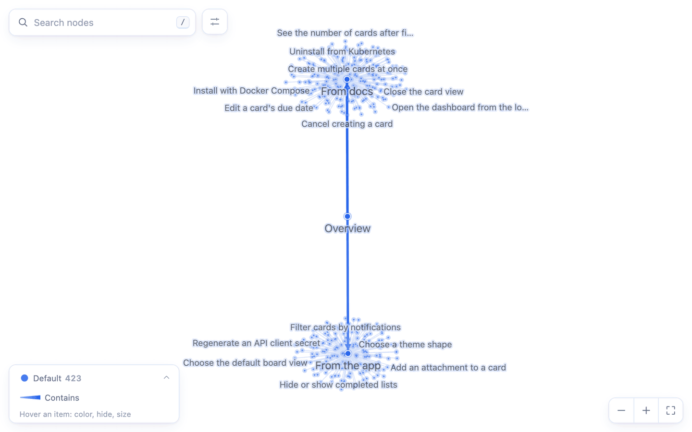
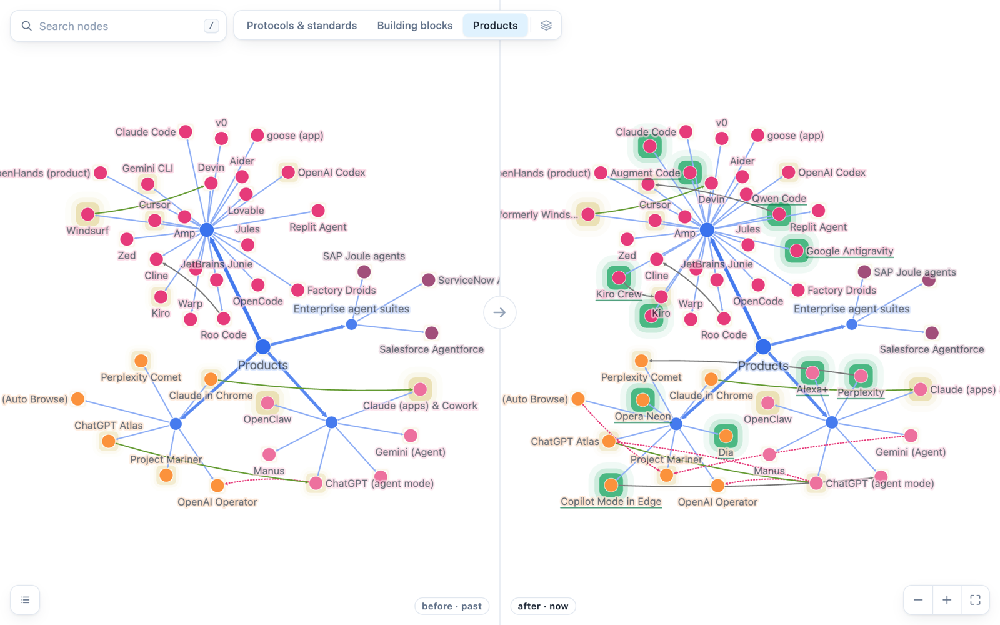
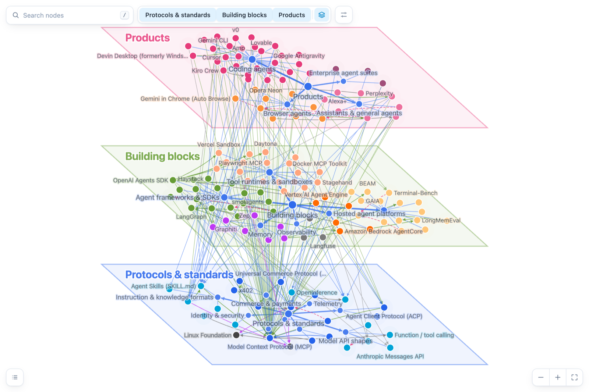

# glassbrain

**Know what your agent knows.**

Your agent keeps knowledge graphs: of your code, your docs, its research, its own plans. glassbrain
lets you read one at a glance, and when the agent learns something, shows you exactly what changed.



```bash
npx glassbrain kg/                  # open a graph in the browser (kg/ = JSON files, or one folder per version)
npx glassbrain diff HEAD~1 kg/      # what changed in the last commit
```

[**Live demo**](https://voidixyn.github.io/glassbrain/) · [Agents write it](#1-a-brain-your-agent-can-write) ·
[Humans read it](#2-read-it-like-a-brain-scan) · [Every brain](#3-every-brain-on-demand) ·
[Try it](#4-try-it-yourself) · [Docs](#docs)

---

## 1. A brain your agent can write

*Two arrays. No SDK.* An agent writes the format with no library and no API:

```json
{
  "nodes": [
    { "id": "src", "label": "src", "kind": "folder" },
    { "id": "src/auth", "label": "auth", "kind": "folder", "parent": "src" },
    { "id": "src/auth/login.ts", "label": "login.ts", "kind": "file", "parent": "src/auth" },
    { "id": "src/db.ts", "label": "db.ts", "kind": "file", "parent": "src" }
  ],
  "edges": [{ "source": "src/auth/login.ts", "target": "src/db.ts", "kind": "uses" }]
}
```

`parent` says what sits inside what; that is the whole structure. Everything else is an edge.
A [JSON Schema](schema/graph.schema.json) describes every field, and the CLI answers in a form an
agent can act on:

```text
$ npx glassbrain validate kg
warn   2-filled/  Dangling edge: points to missing node src/session

kg: 2 versions, 3 nodes, 1 edge — 0 errors, 1 warning

$ npx glassbrain diff kg/1-skeleton kg/2-filled
1-skeleton → 2-filled
nodes: +0 −0 ~1 changed, 0 moved (2 unchanged)
edges: +1 −0 (0 unchanged)

changed (1)
  ~ login.ts  [src/auth/login.ts]  — description
```

Errors exit 1 (`--strict`: warnings too), `diff --exit-code` exits 1 when anything changed, and
`--json` gives the same as structured output. So an agent can build a graph in steps, validate
each one, and check that a step did only its job.

## 2. Read it like a brain scan

*Not a pretty viewer: the widest channel from an agent's memory to your head.* A few hundred
nodes hold more than any report an agent could write you, and a picture of them is read in
seconds: what is there, what sits inside what, what touches what. That only works if the picture
holds still.

Most graph viewers use a force layout: every edge pulls, so a few hundred
relations decide the whole picture, and one change reshuffles all of it. glassbrain takes the
shape from **containment** (folder ⊃ file ⊃ function, area ⊃ feature ⊃ step). Relations are
drawn on top and move nothing. So the picture reads like a map, keeps reading at thousands of
nodes, and **stays where it was** when the graph changes.

That makes change the main event:

- **Step through versions.** A folder of snapshots (`1-skeleton/`, `2-filled/`, …) opens with a
  version bar. Each step is a short animated scene: what leaves is cut loose first, survivors
  move, new things grow out of their parent.
- **Compare two.** Side by side, one shared set of coordinates: what did not change is on the
  same pixel in both panes. Added, removed, changed and moved are marked, and a node that moved
  to a new parent is a *move*, not a deletion plus an addition.
- **Against git.** `npx glassbrain diff main kg/` compares with any commit. The terminal gets a
  summary, the browser gets the picture.



Search ranks by how well a node matches, the detail panel renders the node's markdown, labels
make room for each other instead of piling up, and [dark mode is computed](docs/guide.md#color-hue-is-configured-everything-else-is-computed)
from the light palette. Graphs with layers can be stood up in 2.5D:



## 3. Every brain, on demand

*The model already knows how. Codebase memory, docs knowledge bases, deep research, agent
plans: each is a short skill or a single prompt.*

glassbrain does not build graphs; your agent does. Because the format is two arrays and the CLI
checks every step, there is no extractor, pipeline or embedding store to build: the reach comes
from the model, not from machinery around it. Every dataset in the
[demo](https://voidixyn.github.io/glassbrain/) was made that way by Claude Sonnet 5.5, and each
has a `RUN.md` with the exact prompt and the token count.

| The need | What people use | With glassbrain | In the demo |
|---|---|---|---|
| **Codebase memory** | Graphify, Understand-Anything: a dedicated extractor per tool | [`kg-build`](skills/kg-build/SKILL.md) (a 34-line skill) | [`flask`](data/demo/flask/RUN.md), `glassbrain-src` |
| **Docs knowledge base** | chunk-and-embed RAG, or a custom pipeline | [`docs-to-kg`](skills/docs-to-kg/SKILL.md) (a 94-line skill: two blind passes, merged) | [`boards`](data/demo/boards/RUN.md) |
| **Deep research** | a Deep Research report: thousands of words, read once | a prompt of 80–100 words; the graph is the report, and the next run is a diff | [`agent-stack`](data/demo/agent-stack/RUN.md), [`citations`](data/demo/citations/RUN.md) |
| **Agent plans & explanations** | plan mode, a long spec in markdown | a prompt of 110–135 words: decisions tied to requirements, the self-review as a diff | [`agent-plan`](data/demo/agent-plan/RUN.md), [`how-agents-work`](data/demo/how-agents-work/RUN.md) |
| **Open what you have** | each tool's own viewer | the output of Graphify, Understand-Anything, an MCP memory server or an Obsidian vault, as it is | [`graphify-flask`](data/demo/graphify-flask/RUN.md), [`mcp-wiki`](data/demo/mcp-wiki/RUN.md) |

What that gets you, measured on the demo data:

- **Codebase.** On Flask's `src/flask`, `kg-build` gave 540 nodes (folder ⊃ module ⊃ class ⊃
  method), every one with a description written from the code, and 751 typed edges (imports,
  calls, extends, decorators, signals); 230k tokens. Graphify on the same folder: 892 nodes, none
  described, 257 of them docstring fragments.
- **Docs.** `docs-to-kg` read 4ga Boards' docs and, separately, its UI code: 421 features found,
  merged to 268 in 9 areas, each a user story with steps and expected results. 49 are missing
  from the docs, 93 were found only in the docs, and 94 stories note where docs and app differ.
  Two blind judges (Sonnet 5.5 and Opus 5.5, sets unlabeled and swapped) compared it with an
  earlier multi-stage pipeline of ours on the same product: both picked it "overwhelmingly", and
  23 of 24 sampled stories checked out against the source code, against 11 of 24.
- **Research.** From memory, then checked on the web: the agent-ecosystem graph grew from 130 to
  166 nodes and 25 of the remembered facts were flagged `corrected`. Compare the two snapshots
  and you are reading what the research changed, not a new report.
- **Plans.** The agent's plan for real-time collaboration has every decision linked to the
  requirement it serves and every rejected alternative to the decision that beat it; its
  self-review shows up as 8 nodes added, 1 decision demoted to rejected, 9 changed.

The skills, for any agent that reads `SKILL.md`:

| Skill | What the agent does with it |
|---|---|
| [`kg-build`](skills/kg-build/SKILL.md) | Maps a codebase, docs or a website in three snapshots (skeleton → filled → linked), validating and diffing after each |
| [`docs-to-kg`](skills/docs-to-kg/SKILL.md) | Turns docs plus the product into features as user stories: two independent passes, merged, written up, linked |
| [`kg-view`](skills/kg-view/SKILL.md) | Finds a graph in the project, in any format below, and opens it |
| [`kg-diff`](skills/kg-diff/SKILL.md) | Says what changed since a commit, in a few sentences, and shows it |

```bash
npx skills add voidixyn/glassbrain     # the skills CLI (skills.sh); or copy skills/* into your agent's skills folder
```

Already have a graph from another tool? Open it as it is; the format is detected from the content.

| You have | Open it with |
|---|---|
| [Graphify](https://github.com/Graphify-Labs/graphify) `graphify-out/graph.json` | `npx glassbrain graphify-out/graph.json` |
| [Understand-Anything](https://github.com/Egonex-AI/Understand-Anything) `.ua/knowledge-graph.json` | `npx glassbrain .ua/knowledge-graph.json` |
| [MCP memory server](https://github.com/modelcontextprotocol/servers/tree/main/src/memory) `memory.jsonl` | `npx glassbrain path/to/memory.jsonl` |
| An Obsidian vault or an LLM wiki (markdown + `[[links]]`) | `npx glassbrain my-vault/` |

Each tool's own notion of "inside" becomes the structure; everything else becomes edges.
`npx glassbrain convert <path> <out>` writes any of them as plain glassbrain JSON
([formats](docs/cli.md#formats)).

## 4. Try it yourself

*Light enough to try in a minute.* Nothing is hidden and nothing runs in the background:

- **One file out.** `npx glassbrain` writes a single html page (about 1 MB plus your data): no
  server, no database, no requests of its own, opens from `file://`, can be sent to anyone.
  (Images that node descriptions link to load from their URLs.)
- **Your data stays plain.** JSON files you can read, diff in git and edit by hand. Nothing
  derived (flags, validation, layout) is ever written back into them.
- **No lock-in, no key.** Every supported format comes in, `convert` writes plain JSON out, and
  everything runs locally.

**Three ways in:**

1. Open the [live demo](https://voidixyn.github.io/glassbrain/), or drop a folder of your own JSON onto it.
2. Point it at something you have: `npx glassbrain <file-or-folder>`.
3. Ask your agent, no skill needed:

   > Map how our checkout flow works as a glassbrain graph (run `npx glassbrain` first).

   `npx glassbrain` with no arguments prints the format and how to build in passes, so the
   agent needs nothing else.

   Or give it the skills above and write your own: a skill is a short markdown file.

**In your own app** it is a React component on top of [cytoscape.js](https://js.cytoscape.org/):

```bash
npm i glassbrain cytoscape cytoscape-fcose cytoscape-cose-bilkent
```

```tsx
import { parseSources, diffModels, GraphCanvas } from 'glassbrain';

const model = parseSources([{ origin: 'graph.json', text }]);
<GraphCanvas model={model} />                                         // browse
<GraphCanvas model={after} diff={diffModels(before, after)} />        // compare
```

Colors, layers, field names and your own JSON dialects go in a profile; the canvas can be made
editable and hands you each edit as a patch. All of it is in [the guide](docs/guide.md).

How big it goes (the generated page in headless Chrome on an Apple M4 laptop, [method](docs/cli.md#size)):

| Graph | Ready | Pan / zoom |
|---|---|---|
| 1,000 nodes | 1.1 s | 60 fps |
| 5,000 nodes | 4.7 s | 60 fps |
| 10,000 nodes | 9.7 s | 30 fps |

Beyond about 10,000 nodes, look at [sigma.js](https://www.sigmajs.org/).

## Questions

**Is this a graph database or a graph builder?** Neither. It is the screen: something else
(your agent, Graphify, a script) builds the graph; glassbrain shows it and its changes.

**How is it different from Graphify's or Understand-Anything's own viewer?** Those come with
their extractors. glassbrain opens their output too, and adds stable structure and version
comparison. Use both.

**Can I edit the graph by hand?** Yes, in your app (`onEdit`) or in the demo. Edits are a patch of
small operations, so they can be replayed after the agent regenerates the graph.

## Docs

- [Guide](docs/guide.md): the library: profiles, colors, positions, theming, editing.
- [CLI](docs/cli.md): the commands, the formats they read, and how size was measured.
- [Design](docs/design.md): why it moves the way it does, for contributors and the curious.

## Develop

```bash
npm ci
npm run verify        # typecheck, build, check the package, test
npm run demo:public   # demo/dist/public.html, the page behind the live demo
```

See [CONTRIBUTING.md](CONTRIBUTING.md). Security reports: [SECURITY.md](SECURITY.md).

## License

[MIT](LICENSE)
